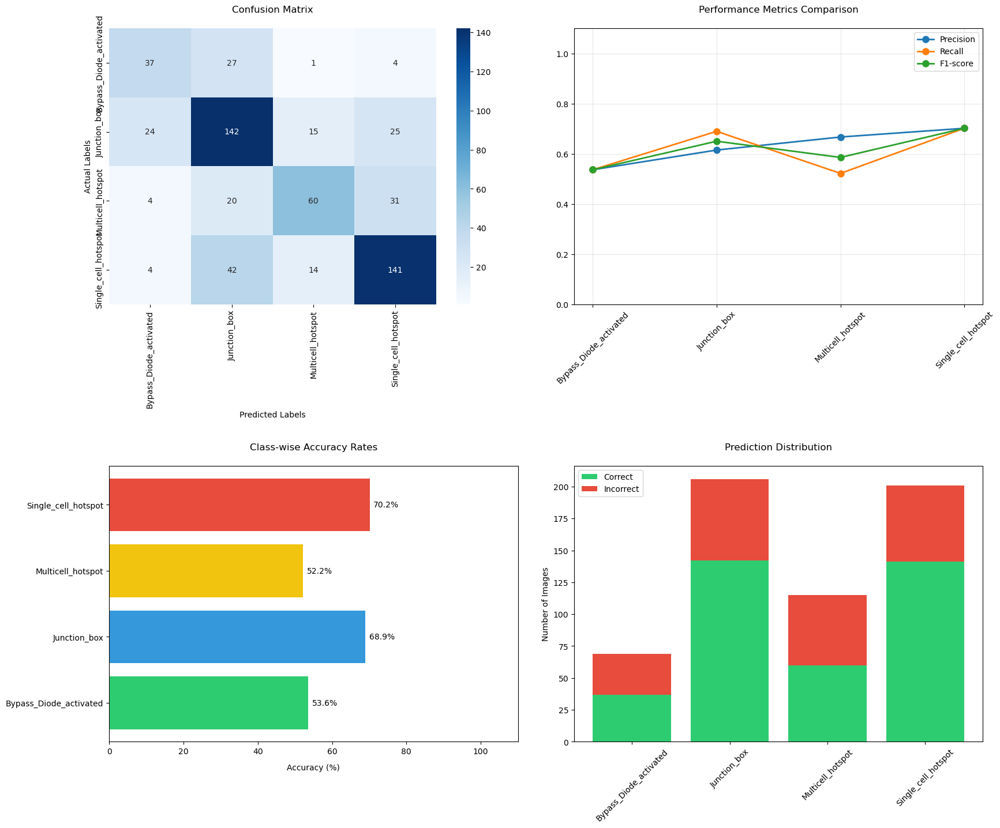
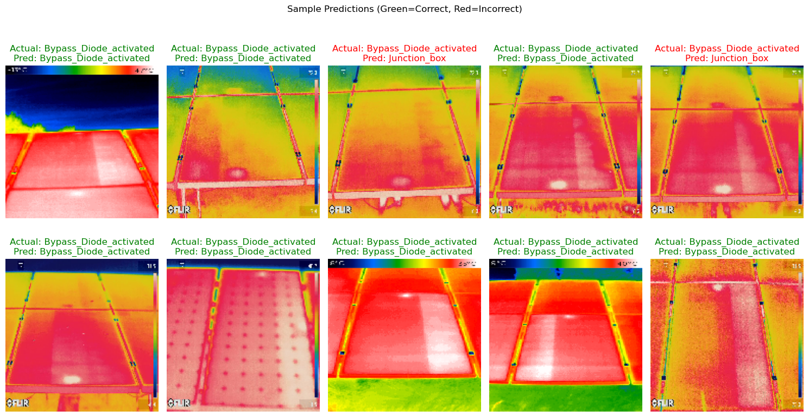

# solar fault classifier

this project implements a convolutional neural network (cnn) for classifying solar panel faults from images. the model detects four types of faults:
- bypass diode activated
- junction box
- multicell hotspot
- single cell hotspot

## project structure

```
.
├── app.ipynb              # jupyter notebook for model training
├── test.ipynb             # jupyter notebook for model evaluation
└── images_classed         # image dataset
```

## installation

1. **clone the repository**:
   ```bash
   git clone https://git.sr.ht/~obk/solar-fault-classifier
   ```

2. **install dependencies**:
   ```bash
   pip install -r requirements.txt
   ```
*note: a gpu is recommended for faster training.*

## usage

### 1. model training (`app.ipynb`)

1. run all cells in `app.ipynb`:
   - trains cnn model with data augmentation
   - monitors training progress through accuracy/loss metrics
   - saves final model as `solar_fault_classifier.h5`

### 2. model evaluation (`test.ipynb`)
1. execute all cells in `test.ipynb`:
   - evaluates model performance (using same images due to data limitations)
   - displays accuracy metrics and visualizations
   - shows prediction comparisons with actual labels



### 3. prediction examples


## key components
- `app.ipynb`: model training notebook
  - cnn architecture with convolutional layers and dropout
  - uses imagedatagenerator for augmentation/validation
  - saves trained model weights

- `test.ipynb`: model evaluation notebook
  - loads pretrained model
  - generates performance metrics
  - creates visualizations of predictions

- dataset structure (`images_classed/`):
  ```
  images_classed/
  ├── bypass_diode_activated
  ├── junction_box
  ├── multicell_hotspot
  └── single_cell_hotspot
  ```
